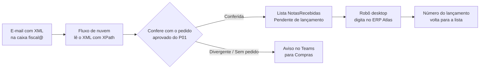

# Robô de Entrada de NF-e · Lumina Componentes

> Projeto de portfólio da **Tucci Digital Solutions**. Lumina Componentes é uma empresa fictícia; todos os dados são fictícios.

As notas fiscais chegam por e-mail, são conferidas com o pedido e lançadas no ERP sem ninguém digitar.

## O problema

Otávio Lima, do Fiscal, recebe cerca de 600 notas por mês na caixa `fiscal@`. Ele abre cada XML, confere com o pedido aprovado e digita no ERP Atlas, um sistema desktop antigo sem API. Divergência de valor só aparece no fechamento.

## A solução



1. Um fluxo de nuvem lê o XML anexado (sem OCR e sem AI Builder: o XML é o documento oficial) e extrai chave, número, emitente, valor e itens.
2. Confere com o pedido aprovado: mesmo fornecedor, pedido Aprovado, valor dentro de 2%. Resultado: Conferida, Divergente (com o motivo) ou Sem pedido. Nota repetida é ignorada e registrada.
3. Divergência vai para o Teams de Compras com o link da nota.
4. Um fluxo do Power Automate para desktop abre o ERP Atlas, faz login, digita cada nota conferida e grava o número do lançamento de volta na lista. Erro no ERP vira `StatusLancamento = Erro` com captura de tela.

O **ERP Atlas** é um simulador construído aqui (C# WinForms, .NET 10) para dar ao robô um alvo realista: tela de login, menu, entrada de nota com itens, validações no estilo de sistema antigo e uma opção para simular falha.

## O que tem neste repositório

| Pasta | Conteúdo |
| --- | --- |
| `FLOWS.md` | Os dois fluxos passo a passo, com as expressões exatas |
| `dados/` | 18 pedidos aprovados, 20 XMLs de NF-e fictícios e o gabarito (14 Conferida, 3 Divergente, 2 Sem pedido, 1 duplicada) |
| `scripts/gerar_notas.py` | Gera os dados a partir da `lumina-seed` (determinístico) |
| `scripts/conferir.py` | Implementação de referência da conferência; confere os 20 XMLs contra o gabarito |
| `infra/criar-listas.ps1` | Cria as listas no SharePoint com PnP PowerShell (e os pedidos de teste, se o P01 não estiver instalado) |
| `infra/enviar-emails-teste.ps1` | Manda os 20 XMLs por e-mail pelo Outlook, simulando os fornecedores |
| `erp-atlas/` | Simulador do ERP (WinForms) e testes (xUnit) |

## Como rodar

**Pré-requisitos:** Windows, .NET 10 SDK, Power Automate para desktop, Microsoft 365 com Outlook, SharePoint e Teams, PowerShell 7 com PnP.PowerShell.

```powershell
# 1. Simulador do ERP
cd erp-atlas
dotnet test
dotnet publish src/ErpAtlas -c Release -o C:\Tucci\ErpAtlas
C:\Tucci\ErpAtlas\ErpAtlas.exe          # usuário FISCAL, senha atlas2026 (fictícios)

# 2. Listas no SharePoint (altera o ambiente: rodar com aprovação)
./infra/criar-listas.ps1 -Site https://SEUTENANT.sharepoint.com/sites/lumina-processos -ClientId <app do PnP>

# 3. Fluxos: montar no designer seguindo o FLOWS.md

# 4. Teste de ponta a ponta
./infra/enviar-emails-teste.ps1 -Para sua.caixa@seudominio.com
```

Conferência sem Microsoft 365: `python3 scripts/conferir.py` (as regras do fluxo, em Python, contra os 20 XMLs).

## Licenças para o cliente

- Fluxo de nuvem: só conectores padrão (Outlook, SharePoint, Teams), incluídos no Microsoft 365.
- Disparar o fluxo de desktop a partir da nuvem exige Power Automate Premium para o usuário do robô (US$ 15 por usuário por mês na data deste projeto; conferir o preço atual antes da proposta). Robô não assistido exige também o complemento de processo. Na demonstração, o fluxo de desktop roda à mão, sem Premium.

## Limitações conhecidas

- Não faz manifestação do destinatário na SEFAZ nem valida a assinatura digital do XML.
- Não lê DANFE em PDF sem XML.
- A conferência compara o valor total; a conferência item a item (quantidade e preço por produto) fica como evolução.

---

*Dados fictícios. Lumina Componentes não existe.* Feito pela [Tucci Digital Solutions](https://tuccidigital.com).
